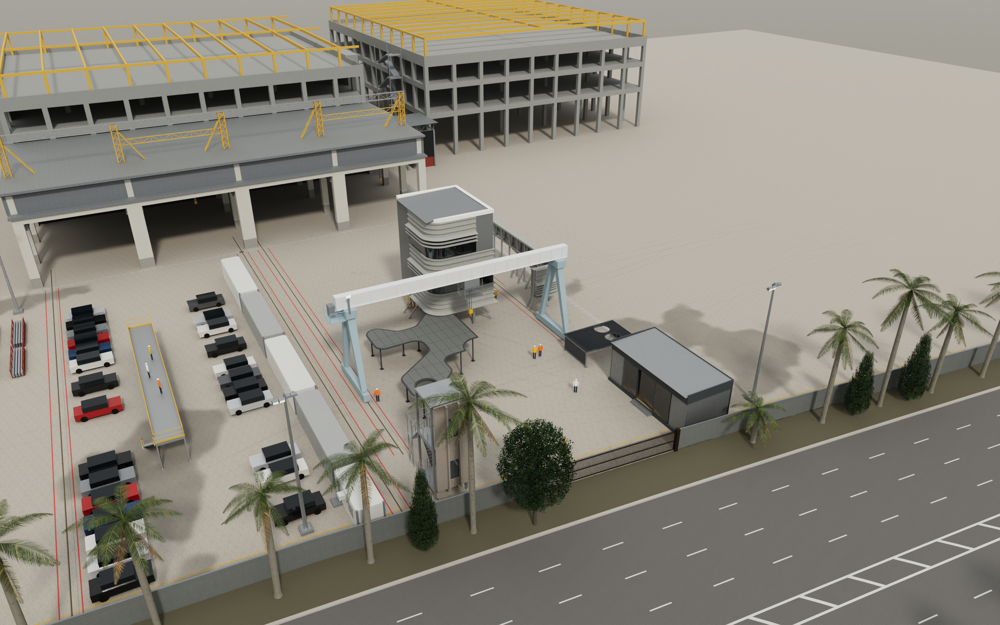
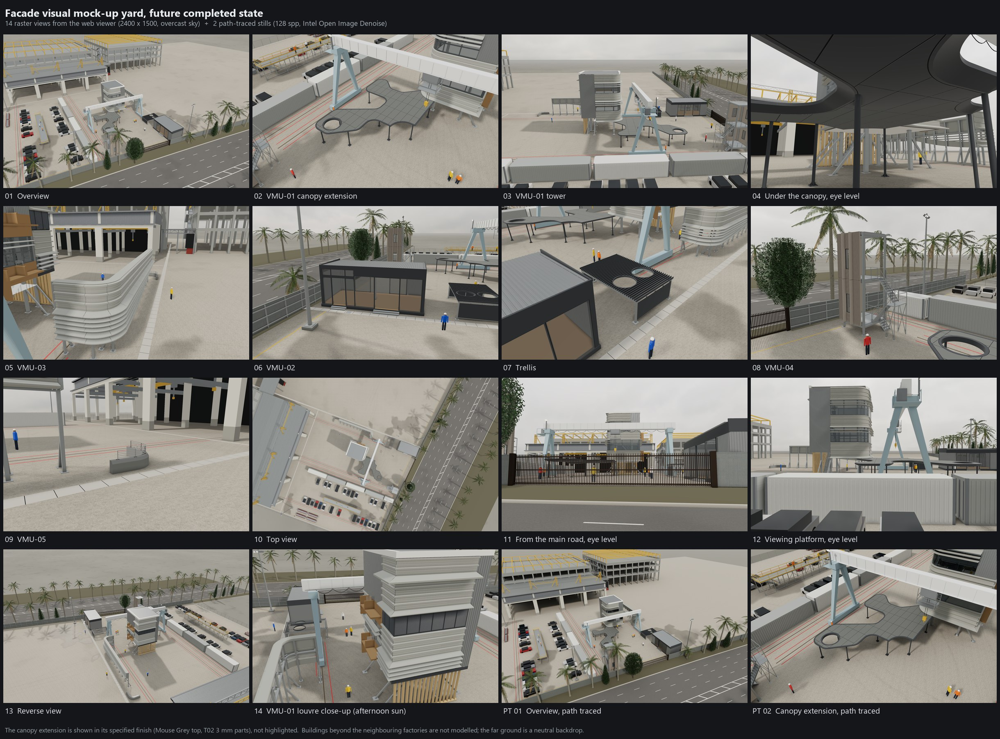

# Facade visual mock-up yard: future completed state



A three.js web viewer and a Rhino 8 model of five facade visual mock-ups (VMU-01 to VMU-05) in a precast yard, in their
planned completed state, including the VMU-01 canopy extension.

- **Built here:** Python builders that turned shop drawings, a legacy CAD model, a site survey and site photos into seven
  GLBs (2,223,601 triangles); a WebGL2 viewer with path-traced, OIDN-denoised stills; a hardened local save/denoise
  server; and a Rhino 8 export with independent readback QA.
- **Checked:** the Rhino export keeps all 621,885 source UV coordinates exactly and loses no surface area after culling
  1,012 degenerate faces; 129 of its 235 mesh components are closed and 101 are solid.
- **Limits:** the drawings, CAD model, survey and photos are confidential and not included, so the builders cannot run
  here and the plan-fit, colour and camera checks are reported rather than reproducible; this is a mesh reference
  model, not BIM elements; several finishes still await site confirmation.

### What this repository adds, and what comes from the sources

- **From the confidential sources:** the facade designs, dimensions and specified finishes of the five mock-ups (shop
  drawings and element specifications), the VMU-01 tower, VMU-03 and trellis render meshes (legacy CAD model), the
  yard layout plan and the surveyed lot lines.
- **Produced by the code in this repository:** the parametric rebuilds of the VMU-01 canopy and extension, VMU-02,
  VMU-04 and VMU-05 from those specifications, the placement of the legacy CAD meshes on the layout plan, the yard and
  surroundings (`build/build_ground.py`, `build/build_context2.py`, `build/build_features2.py`), the viewer and
  local server, the Rhino export and every check and test listed below.

## What is in the model

- **Mock-ups.** The model contains:
  - the VMU-01 tower, with its canopy and the canopy extension;
  - the curved VMU-03, and VMU-02, VMU-04 and VMU-05;
  - a trellis;
  - the yard around them: ground slab, drains, crane runways, gantry crane, sheds, containers, hoarding, viewing
    platform and high masts, with a generic main road and roadside planting outside the hoarding.
- **Size.** Seven glTF files hold 2,223,601 triangles. The same model is also provided as a Rhino file:
  `model/vmu_site_future.3dm`, in millimetres, with 235 mesh components + 1 information TextDot,
  245 layers and 44 materials. The Rhino export has 2,222,589 valid triangles after removing 1,012
  degenerate faces, with no measured loss of surface area. Source GLBs are unchanged.
- **Colour table.** `model/materials.json` contains 87 named records, including 38 aliases. Thirteen records carry
  SCI/SCE colour fields: seven canonical entries and six aliases, not thirteen independently measured finishes.
  These include the indicative VMU-04 precast value. The four `CTX_*` display finishes are registered from the public GLB values.
  The renders use SCE (specular component excluded).
  Where a finish is specified by RAL number, the number is kept: RAL 7005, RAL 7038 and RAL 9016.
- **Canopy extension.** The default finish is a Mouse Grey top with T02 3 mm parts; the RAL 7038 option is an explicit comparison.
  The viewer can draw an outline around it (the outline toggle, or `?outline=1`), but it is never tinted.

## Run the viewer

You need Python 3 and a browser with WebGL2 (a current Chrome or Edge). The viewer uses only the Python standard library.

```
python serve.py            # default port 18090
```

Then open **http://127.0.0.1:18090/index.html**. On Windows you can double-click `start_viewer.bat` instead; it starts
the server and opens the page.

What the viewer does:

- **Views and lighting.** It has 13 preset views. The sun position is computed for 1.3° N 103.8° E, UTC+8, from a date
  and time you choose. You can pick an overcast or a partly cloudy sky (CC0 HDRIs). GTAO ambient occlusion and SMAA
  anti-aliasing are on.
- **Tools.** Click any element to see its layer and finish. There is also a distance tool and PNG export.
- **URL options.** You can set these in the address bar:
  - `?date=YYYY-MM-DD&t=<minutes>` sets the date and time;
  - `?hdri=sunny` switches to the partly cloudy sky;
  - `?canopyScheme=ral7038` shows the alternative canopy finish;
  - `?outline=1` outlines the canopy extension.
- **Path-traced stills.** The *照片级静帧* panel runs three-gpu-pathtracer in the browser. `serve.py` then denoises the
  result with Intel Open Image Denoise, using the albedo and normal buffers, and applies fog and ACES tone mapping.
  - OIDN needs numpy and a local `OpenImageDenoise.dll`. By default the copy that ships with Rhino 8 is used; set
    `OIDN_DLL` to point to another copy.
  - Without OIDN, the viewer falls back to an in-browser denoiser.
  - On some integrated GPUs the path tracer renders correctly only when Chrome or Edge is started with
    `--use-angle=vulkan`.

The user interface is in Chinese.

### Saving stills locally

The toolbar's PNG export downloads an image through the browser. The scripted `window.__poseShot` and
`window.__shots` helpers instead use `POST /save?name=<filename>.png` on the local server. They report failed saves
and restore the interactive camera, render size and labels even when an export fails. An existing file returns
HTTP 409 by default. To deliberately rerender a fixed filename, pass `{ overwrite: true }` as the helper's final
options argument; this sends `overwrite=1` and replaces the complete file atomically. The historical
`build/validate.py` runner uses fixed names without that option, so move its previous outputs aside before repeating
it (the private source inputs are still required).

The save endpoint accepts PNG data URLs, validates PNG framing and image data, and requires a local Host and matching
Origin for browser requests. Requests are limited to 64 MiB and expanded PNG image data to 256 MiB. Default saves use
a temporary file and a hard link to avoid overwriting another save; use a filesystem that supports hard links (for
example NTFS or ext4). A filesystem failure returns HTTP 500 and does not silently overwrite the destination.
This is a loopback development server, not a public upload service.

### Check the public viewer

From the repository root, with Python 3.12 and Node.js 22:

```sh
python -B checks/validate_assets.py
python -B checks/check_readme.py
python -B checks/scan_local_paths.py
python -B -m unittest discover -s tests -p "test_*.py"
node --test tests/viewer-lifecycle.test.cjs
```

The same commands run in CI on Windows and Ubuntu without installing packages or requiring the private build inputs.
`check_readme.py` recomputes the counts quoted in both READMEs from the committed QA files, inventory, colour table
and images; `scan_local_paths.py` fails on local machine paths in tracked files.
The asset check reads all seven published GLBs, checks their buffer/accessor bounds, indices and finite values, and
checks local module and texture dependencies. It supports the dense FLOAT VEC2/VEC3 and UINT32 triangle profile used
here; it is not a general glTF conformance validator. Every public GLB material name must be registered in the
current colour table, including the four `CTX_*` finishes that previously used viewer fallbacks.

Python regressions exercise the real HTTP server with temporary files. JavaScript regressions execute the viewer's
actual interaction functions with controlled I/O and GPU boundaries, including cancelled or superseded renders and
failed exports. These checks do not run WebGL, evaluate OIDN image quality, rerun source-model accuracy checks, or
reproduce the historical render timings. For visual verification, open the viewer in a WebGL2 browser, check both
desktop and narrow layouts, clear and restore the date field, measure with scene labels hidden, and cancel a still
render before returning to the live view. Optional models that fail to load should appear in the load warning.

## Use Rhino 8

Open `model/vmu_site_future_native.3dm` in Rhino 8 for embedded PBR images and all
13 named views; `model/vmu_site_future.3dm` retains the geometry/source-UV baseline.
The native file (121 MB) is stored in Git LFS: install Git LFS before cloning, or run
`git lfs pull` in an existing clone. Without it the file is a small text pointer.
Meshes retain their source UVs
(194 meshes / 621,885 UV coordinates), stable source-derived object GUIDs and component UserText.
Use `rhino/select_components.py` in `ScriptEditor` to select by group, finish, role or ID.
`model/vmu_site_future_inventory.csv` provides a checked inventory of the 235 mesh components.
See [the Rhino workflow](rhino/README.md) for public-file regeneration, validation and native Rhino QA.
The native delivery adds world mapping to 41 meshes without source UVs, embeds
19 image assets for 8 finishes at their physical scale, and includes 13 native
1600 × 1000 viewport captures in `renders/rhino/`. The full quality CSV reports
129 closed / 106 open / 101 solid meshes and supplies volume only for solids.
This remains a mesh reference model; browser GLSL effects and engineering element
classes are not inferred. See [the native contact sheet](renders/rhino/contact_sheet.jpg).

### Check or rebuild the Rhino delivery

These commands need Python 3.12 or newer (CI uses 3.13; the pinned NumPy 2.5.3 has no Python 3.11 build) and the
LFS-fetched native file. On Windows:

```powershell
python -m venv .venv
.\.venv\Scripts\python.exe -m pip install -r requirements-rhino.txt
.\.venv\Scripts\python.exe build\delivery.py --check
```

The full `--check` is Windows-only: the derived PNG assets that `prepare_rhino_assets.py --check` compares byte for
byte came out different on Ubuntu in CI. On Linux or macOS, the geometry readback and the README figures still run:

```sh
python3 -m venv .venv
.venv/bin/python -m pip install -r requirements-rhino.txt
.venv/bin/python build/check_3dm.py
.venv/bin/python checks/check_readme.py --rhino
```

Offline `--check` verifies the committed delivery index, source geometry, canonical material derivation, mesh
topology, native PBR scalars, cameras and captures without starting Rhino or rewriting reports. CI runs it on
Windows and runs the two Linux commands above on Ubuntu. `--rebuild` (Windows only) needs licensed
Rhino 8 and a one-time `python -m playwright install chromium`; it refreshes the public GLB source export, textures,
cameras, native model, captures and independent reports. All subprocesses use the selected interpreter.

`model/delivery_index.json` records source/code/configuration fingerprints, output fingerprints, Python/dependency
versions and the native Rhino version; changed inputs or outputs invalidate the old delivery. Text fingerprints
normalize Git line endings; model and image fingerprints use exact bytes. Code and documentation changes made
without a Rhino rebuild are recorded in its `read_only_verification` block after the offline checks pass; they do
not regenerate any model, render or private-source measurement.

## Renders



`renders/` holds 16 stills at 2400 × 1500 pixels:

- 14 raster views from the viewer (`01_overview.png` to `14_vmu01_louvre_closeup.png`), under an overcast sky with a
  morning sun. View 14 is lit by an afternoon sun instead.
- 2 path-traced stills, `pt_01_overview.png` and `pt_02_vmu01_canopy_extension.png`. Each was rendered at 128 samples
  per pixel and denoised with OIDN. On an integrated GPU they took about 10 and 16 minutes of tracing.

The PNG and JPEG files carry no text or EXIF metadata.

## Repository layout

```
index.html, viewer.js   web viewer (three.js r160 + three-gpu-pathtracer, vendored in vendor/)
serve.py                local server: static files, POST /save (screenshots -> renders/), POST /pt_denoise
ptdenoise.py            OIDN denoising + fog + ACES tone mapping for path-traced stills (optional)
start_viewer.bat        Windows launcher (python on PATH)
model/                  vmu_cad.glb          VMU-01 tower, VMU-03, trellis            71.2 MB
                        vmu01_canopy.glb     VMU-01 canopy + canopy extension          3.2 MB
                        vmu02.glb, vmu04.glb, vmu05.glb                                 2.5 MB
                        site_ground.glb      slab, drains, runways, generic road       1.3 MB
                        site_context.glb     sheds, gantry, containers, hoarding       2.1 MB
                        materials.json       colour table (87 registered materials)
                        site_features.json   palms, trees, people, vehicles, labels
                        vmu_site_future.3dm  the whole model for Rhino (mm)           62.9 MB
                        vmu_site_future_native.3dm     textured Rhino model with named views (Git LFS)
                        vmu_site_future_inventory.csv  checked mesh-component inventory
                        vmu_site_future_qa.json        GLB/Rhino comparison report
build/                  public Rhino export/checker + private-source modelling scripts (see build/README.md)
rhino/                  Rhino 8 component selector, native QA and workflow
checks/                 asset, README-figure and local-path checks (standard library only)
tests/                  HTTP server, asset, README-figure and viewer regression tests
textures/               CC0 textures and HDRIs (Poly Haven, ambientCG)
vendor/                 three.js, three-mesh-bvh, three-gpu-pathtracer (MIT)
renders/                16 stills + contact_sheet.jpg
THIRD_PARTY_LICENSES.md
```

## How accuracy was checked

### Checked from the files in this repository

- **Rhino roundtrip.** The seven GLBs and the viewer still contain 2,223,601 source triangles. Rhino contains
  2,222,589 triangles after culling 1,012 degenerate faces from 11 previously invalid meshes. The checker finds
  no surface-area loss, verifies source triangle membership/winding, and compares all 621,885 UV coordinates
  exactly. The native objects and inventory share stable source-derived IDs. Bounding-box round-off is at most
  0.007568359375 mm. Evidence: `model/vmu_site_future_qa.json` and `model/vmu_site_future_native_source_qa.json`,
  recomputed by `build/check_3dm.py`.
- **Published assets.** `checks/validate_assets.py` rereads all seven GLBs, their materials and dependencies.
- **README figures.** `checks/check_readme.py` recomputes the counts quoted in both READMEs from the committed files.

### Private-source checks (reported, not reproducible here)

These checks need the confidential drawings, the source renders and the element-ID masks. Those inputs, the
colour-crop script and the result files are not published, so the figures below are the values reported by the
private run and cannot be recomputed from this repository.

- **Plan fit.** The plan edges of each unit were compared with the layout drawing. The check measured the nearest
  distance in both directions, then ran a trimmed ICP re-fit (`build/validate.py`, which needs the private inputs).
  - The re-fit would move a unit by at most 0.053 m (VMU-04).
  - For the other units, the canopy and the trellis, it would move them by 0.031 m or less.
  - These checks ran on the source model. The binary chunks of the five mock-up GLBs were compared with the source
    files and reported byte-identical. The ground and surroundings (`site_ground.glb`, `site_context.glb`,
    `site_features.json`) were rebuilt for publication with the scripts in `build/` (see Limitations).
- **Colour crops.** The published raster renders were measured with element-ID masks for five elements: canopy top,
  roof coping, VMU-01 fins, VMU-04 precast and wood-grain aluminium. The private run reported all 48 of 48 crops
  inside their tolerance windows:
  - CIELAB ΔL* / Δb* windows against the preceding baseline renders;
  - hue 32–38° and saturation 0.36–0.47 for the wood grain;
  - |b*| ≤ 3.5 for the white coping.

  Against the source renders, the mean colours of the masked crops were reported within 0.15 in L*, a* and b*,
  except where the rebuilt surroundings (roadside trees, their shadows, the west factory and the gantry crane) change
  the masked pixels: views 01, 07 and 11, up to 20.7 in L* for the VMU-04 precast in view 11.
- **Cameras.** The 13 standard views were reported to reproduce the source camera positions and targets to within
  0.01 m.

## Limitations

- **Future state.** The model shows the planned completed state. Several finishes and dimensions are still waiting to
  be confirmed by site measurement. The VMU-04 precast colour is an indicative value.
- **Build scripts.** The geometry builders in `build/` record the method and read confidential inputs that are not
  included (drawings, a CAD model, a site survey and site photos). The Rhino exporter, checker and regression tests
  run directly from the committed public GLBs and material table; they do not rebuild the private source geometry.
- **Still-render preparation.** Geometry/BVH preparation and parts of the first shader compilation run synchronously
  on the browser's main thread. The exit button may respond only when that work yields. Cancellation isolates late
  asynchronous results; it cannot interrupt those synchronous GPU/geometry operations.
- **Surroundings.** Only the factories and structures next to the yard are modelled, from the layout plan, the site
  survey and site photos; buildings further away are not modelled. The sheds, the accessway canopy, the gantry crane,
  vehicles and people are approximate. The far ground is a neutral textured plane, not imagery.
- **Main road and planting.** The main road is generic: a dual carriageway laid out along the surveyed lot line with
  nominal widths (four 3.5 m lanes per direction, a 2 m hatched median, 4 m verges), standard markings and a level
  assumed 0.5 m below the yard. The palms and trees along it are procedural rows, not surveyed positions. The second
  crane runway, which the layout plan does not show, is placed from a site photo.
- **Coordinates.** Model coordinates are local metres from a yard origin, with no georeferencing. The sun model is the
  simplified NOAA algorithm at rounded coordinates.
- **Lot line.** The yard slab, the hoarding and the chain-link fence follow the surveyed lot lines at survey accuracy.
  `model/site_features.json` carries only a copy of the lot line rounded to 1 m, which the viewer uses to place views.

## Data and licences

- **Third-party components.** See [THIRD_PARTY_LICENSES.md](THIRD_PARTY_LICENSES.md):
  - three.js, three-mesh-bvh and three-gpu-pathtracer are MIT-licensed;
  - the Poly Haven and ambientCG textures and HDRIs are CC0;
  - Intel Open Image Denoise (Apache-2.0) is not included; it is loaded from a local installation.
- **Excluded data.** The repository contains no aerial or map imagery, no geometry or values measured on aerial
  imagery, map tiles or terrain data, no building data from online maps, no licensed height data and no site
  photographs. The road, the roadside planting, the second crane runway, the accessway canopy and the colours of the
  surroundings come from the drawings, the site survey, site photos or generic values (see
  [build/README.md](build/README.md)).
- **No licence is granted** for the model, renders, scripts or documentation in this repository. All rights are
  reserved unless the owner adds a LICENSE file. Third-party components remain under their own licences.

中文说明见 [README.zh-CN.md](README.zh-CN.md)。
