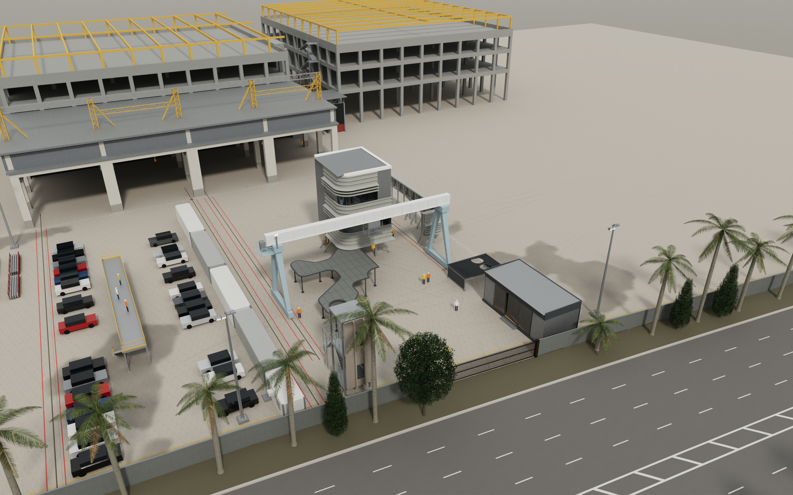

# 幕墙视觉样板场地：完工状态模型



预制构件堆场中五组幕墙视觉样板（VMU-01 至 VMU-05）计划完工状态的 three.js 网页查看器与 Rhino 8 模型，含 VMU-01 雨棚延伸。

- **本仓做了什么**：用 Python 构建脚本把加工图、旧版 CAD 模型、场地测量和现场照片转成 7 个 GLB（共 2,223,601 个三角面）；WebGL2 查看器及路径追踪、OIDN 降噪静帧；加固过的本地保存/降噪服务；带独立回读核对的 Rhino 8 导出。
- **核对结果**：Rhino 导出逐一保留全部 621,885 组源 UV，剔除 1,012 个退化三角面后表面积无损失；235 个网格构件中 129 个闭合、101 个为实体。
- **局限**：图纸、CAD、测量和照片属保密资料，未随仓发布，因此构建脚本无法在本仓运行，平面、色块和相机核对只能报告、不能复现；这是网格参考模型，不是 BIM 构件；部分饰面仍待现场确认。

### 本仓产出与来源资料的分界

- **来自保密资料**：五组样板的立面设计、尺寸和指定饰面（加工图与构件规格）、VMU-01 塔楼、VMU-03 和 Trellis 的渲染网格（旧版 CAD 模型）、场地布置图及测量红线。
- **由本仓代码生成**：依据上述规格参数化重建的 VMU-01 雨棚及延伸、VMU-02、VMU-04、VMU-05，旧版 CAD 网格在布置图上的定位，场地与周边（`build/build_ground.py`、`build/build_context2.py`、`build/build_features2.py`），查看器与本地服务，Rhino 导出及下文列出的全部检查与测试。

## 模型内容

- **样板与场地**：包括 VMU-01 塔楼及其雨棚（既有部分加新增延伸）、弧形的 VMU-03、VMU-02、VMU-04、VMU-05 和 Trellis，以及周围场地：地坪、排水沟、龙门吊轨道与龙门吊、厂房、集装箱、围挡、观景平台和高杆灯；围挡外为通用示意的主路和路边绿化。
- **规模**：7 个 glTF 文件共 2,223,601 个三角面。同一模型另有 Rhino 格式 `model/vmu_site_future.3dm`，单位为毫米，含 235 个网格构件和 1 个说明文字点、245 个图层及 44 个材质。Rhino 版剔除 1,012 个退化三角面后共有 2,222,589 个有效三角面，核对未损失表面积；源 GLB 保持不变。
- **色值表**：`model/materials.json` 有 87 条命名记录，其中 38 条为别名。13 条记录包含 SCI/SCE 色值，实际为 7 条主记录及 6 个别名，并非 13 个独立实测饰面；其中也包含 VMU-04 预制件的示意色值。四种 `CTX_*` 显示饰面现已按公开 GLB 值登记。渲染采用 SCE 值（不含镜面反射）。按 RAL 指定的饰面保留 RAL 编号：RAL 7005、RAL 7038、RAL 9016。
- **雨棚延伸**：默认顶板为 Mouse Grey，3 mm 件为 T02；RAL 7038 选项用于显式对比。描边开关只标出延伸范围，不改变饰面。


## 运行

需要 Python 3（只用标准库）和支持 WebGL2 的浏览器（Chrome 或 Edge）。启动服务：

```
python serve.py            # 默认端口 18090
```

然后打开 **http://127.0.0.1:18090/index.html**。在 Windows 上也可以直接双击 `start_viewer.bat`。

查看器的主要功能：

- 13 个预设视角。
- 日照按 1.3°N 103.8°E（UTC+8）计算，可自选日期与时间。
- 天空可选阴天或晴间多云（CC0 HDRI）。
- 默认开启 GTAO 与 SMAA。
- 点击构件可查看图层与饰面，另有测距和截图导出。
- “照片级静帧”面板在浏览器内用 three-gpu-pathtracer 进行路径追踪，再由 `serve.py` 调用 Intel Open Image Denoise 降噪。
  - OIDN 需要 numpy 和一个 `OpenImageDenoise.dll`，默认使用 Rhino 8 自带的那份，也可以用环境变量 `OIDN_DLL` 指定其他位置。
  - 没有 OIDN 时，查看器改用浏览器内降噪。
  - 部分集成显卡需要以 `--use-angle=vulkan` 启动 Chrome 或 Edge，路径追踪才能正确出图。

### 本地保存静帧

工具栏的 PNG 导出由浏览器下载图片；脚本接口 `window.__poseShot` 和 `window.__shots` 则通过本地服务的 `POST /save?name=<文件名>.png` 保存。保存失败会报错，并恢复相机、渲染尺寸和标签。默认遇到同名文件返回 HTTP 409；确需重新渲染并替换原图时，在接口最后的选项参数传入 `{ overwrite: true }`，服务会在完整写入后原子替换。历史 `build/validate.py` 使用固定文件名且没有此选项，重复运行前需先移走上次输出；该脚本仍需要未公开的源资料。

保存接口校验 PNG 数据 URL、图片结构和解压后的图像数据，浏览器请求的 Host 和 Origin 必须对应本地服务。请求上限为 64 MiB，解压后图像数据上限为 256 MiB。默认保存通过临时文件和硬链接避免并发覆盖，需要支持硬链接的文件系统（如 NTFS、ext4）；文件系统错误返回 HTTP 500，不会悄悄覆盖目标。服务仅监听本机，不适合作为公共上传服务。

### 检查公开查看器

在仓库根目录使用 Python 3.12 和 Node.js 22 执行：

```sh
python -B checks/validate_assets.py
python -B checks/check_readme.py
python -B checks/scan_local_paths.py
python -B -m unittest discover -s tests -p "test_*.py"
node --test tests/viewer-lifecycle.test.cjs
```

CI 在 Windows 和 Ubuntu 上执行同样检查，无需安装额外包或取得保密输入。`check_readme.py` 用已提交的 QA 文件、清单、色值表和图片重新计算中英文说明中引用的数字；`scan_local_paths.py` 发现受版本控制的文件含本机路径时报错。资产检查读取 7 个公开 GLB，核对缓冲区、访问器、实际索引、数值，以及本地模块和纹理依赖。它只支持本仓使用的密集 FLOAT VEC2/VEC3 与 UINT32 三角面格式，不是完整的 glTF 标准校验器。全部公开 GLB 材质名均需在现行色值表中登记；旧查看器曾使用的四种 `CTX_*` 备用饰面现已显式登记。

Python 回归通过临时文件测试实际 HTTP 服务；JavaScript 回归运行查看器中的实际交互函数，在 I/O 和 GPU 边界控制时序，检查取消、重启和导出失败等行为。这些检查不运行 WebGL，不验证 OIDN 图像质量，不重做源模型精度核对，也不复现历史渲染耗时。视觉核验需在 WebGL2 浏览器中检查桌面和窄屏布局、清空并恢复日期、隐藏场地标签后测距、取消静帧后回到实时视图；可选模型载入失败时应显示缺失提示。

## 在 Rhino 8 中使用

打开 `model/vmu_site_future_native.3dm` 使用带内嵌 PBR 图片和 13 个命名视图的版本；`model/vmu_site_future.3dm` 保留几何与源 UV 基线。原生版本（121 MB）存放在 Git LFS 中：克隆前先安装 Git LFS，或在已有克隆中运行 `git lfs pull`，否则得到的只是一个文本指针。Rhino 网格保留了源 UV（194 个网格，共 621,885 组坐标）、稳定的源构件 GUID 和对象 UserText。可在 Rhino 的 `ScriptEditor` 中运行 `rhino/select_components.py`，按组、饰面、角色或构件 ID 选择对象；`model/vmu_site_future_inventory.csv` 是经过核对的 235 行网格构件清单。

原生版本为缺少 UV 的 41 个网格补上与网页一致的世界投影映射，将 8 种饰面的 19 张图片按物理尺寸、色彩空间和 ARM 通道规则转换并内嵌。`renders/rhino/` 提供 13 张 1600×1000 的 Rhino Rendered 视口图及[联系图](renders/rhino/contact_sheet.jpg)。完整几何质量清单记录闭合、流形、定向、实体、连通片、裸边与面积：129 个闭合、106 个开放、101 个实体、0 个无效网格；仅实体记录体积，其他对象逐一解释省略原因。

详见 [Rhino 工作流程](rhino/README.md)，其中提供仅依赖公开文件的全部重建与独立回读方法。该模型仍是网格协调与参考模型；浏览器自定义 GLSL 效果、植被、日照后处理以及完整 BIM 构件语义不能由图片资产直接转换，原生视口图不宣称与网页照片级渲染完全相同。

### 检查或重建 Rhino 交付

需要 Python 3.12 或更新版本（CI 用 3.13；锁定的 NumPy 2.5.3 没有 Python 3.11 的安装包），并已取得 LFS 原生文件。Windows：

```powershell
python -m venv .venv
.\.venv\Scripts\python.exe -m pip install -r requirements-rhino.txt
.\.venv\Scripts\python.exe build\delivery.py --check
```

完整的 `--check` 只能在 Windows 上运行：`prepare_rhino_assets.py --check` 逐字节比对的派生 PNG 资产在 CI 的 Ubuntu 上生成结果不同。在 Linux 或 macOS 上仍可运行几何回读和说明数字核对：

```sh
python3 -m venv .venv
.venv/bin/python -m pip install -r requirements-rhino.txt
.venv/bin/python build/check_3dm.py
.venv/bin/python checks/check_readme.py --rhino
```

离线 `--check` 核对交付索引、源几何、标准材质派生、网格拓扑、原生 PBR 数值、相机和截图，不启动 Rhino，也不重写报告。CI 在 Windows 上运行完整检查，在 Ubuntu 上运行上面两条 Linux 命令。`--rebuild`（仅 Windows）需要有许可的 Rhino 8，并需先运行一次 `python -m playwright install chromium`；它会重新生成公开 GLB 导出、纹理、相机、原生模型、截图和独立报告。

`model/delivery_index.json` 记录源码/配置指纹、产物指纹、Python 与依赖版本及原生 Rhino 版本，输入或产物变化即视为交付过期。未经 Rhino 重建的代码和文档修改，在离线检查通过后记录于其中的 `read_only_verification`，不会重新生成模型、渲染图或保密资料精度测量。


## 渲染图

`renders/` 下共有 16 张 2400×1500 的静帧，另有总览图 `contact_sheet.jpg`：

- 14 张光栅视图，阴天天空；其中图 14 为下午光照。
- 2 张路径追踪静帧，每张 128 spp，经 OIDN 降噪。

渲染图不含 EXIF 或其他文字元数据。

## 精度核对

### 可用本仓文件核对

- **Rhino 回读核对**：7 个 GLB 与查看器仍为 2,223,601 个三角面；Rhino 版移除原有 11 个无效网格中的 1,012 个退化三角面后为 2,222,589 个有效三角面，表面积损失为 0.0 m²。检查器核对源三角面的归属及绕向、全部 621,885 组 UV、构件 ID 与清单，UV 误差为 0，包围盒舍入误差最大 0.007568359375 mm。依据为 `model/vmu_site_future_qa.json` 和 `model/vmu_site_future_native_source_qa.json`，可由 `build/check_3dm.py` 重新计算。
- **公开资产**：`checks/validate_assets.py` 重新读取 7 个 GLB 及其材质和依赖。
- **说明中的数字**：`checks/check_readme.py` 用已提交文件重新计算中英文说明引用的数字。

### 保密资料核对（仅报告，本仓无法复现）

以下核对需要保密图纸、源渲染图和构件 ID 掩膜；这些输入、色块脚本和结果文件均未发布，下列数字是私有运行报告的值，无法用本仓文件重新计算。

- **平面位置**：将各单元的平面轮廓与布置图对比，先计算双向最近距离，再做 trimmed ICP 重新配准（`build/validate.py`，需要保密输入）。
  - 重新配准所需的最大位移为 0.053 m（VMU-04）。
  - 其余单元、雨棚和 Trellis 的位移均不超过 0.031 m。
  - 以上核对在源模型上完成。5 个样板 GLB 的二进制块曾与源文件比对，报告为逐字节一致；地坪与周边（`site_ground.glb`、`site_context.glb`、`site_features.json`）为公开发布而用 `build/` 中的脚本重新生成（见“局限”）。
- **色块核对**：用构件 ID 掩膜检查已发布的光栅渲染图，涉及雨棚顶板、压顶、VMU-01 翅片、VMU-04 预制件和木纹铝五类构件。私有运行报告 48 个色块全部落在容差范围内。与源渲染图相比，各色块平均色在 L*、a*、b* 上相差不超过 0.15；例外是重新生成的周边（路边树木及其阴影、西侧厂房、龙门吊）改变了掩膜像素的视图 01、07、11（最大为视图 11 中 VMU-04 预制件的 L* 相差 20.7）。
- **相机**：报告称 13 个标准视角的相机位置与目标点和源视角相差不超过 0.01 m。

## 局限

- 模型表现的是计划中的完工状态。部分饰面和尺寸仍待现场测量确认；VMU-04 的预制件颜色为示意值。
- `build/` 中从图纸重建几何的脚本只作为方法记录，依赖未公开的保密输入。Rhino 导出器、回读检查器及其测试可仅使用仓库已提交的 GLB 与材质表直接运行，见 [Rhino 工作流程](rhino/README.md)。
- 静帧的几何/BVH 准备及部分首次着色器编译在浏览器主线程上同步执行，这期间退出按钮可能要等计算让出线程后才响应。取消能隔离异步返回结果，但不能中断这些同步操作。
- 只对场地旁的厂房和构筑物建模（依据布置图、场地测量数据和照片），更远的建筑不建模。厂房、通道雨棚、龙门吊、车辆与人物均为近似表达。远景地面为示意纹理，不是实景影像。
- 主路为通用示意：沿测量红线布置的双向分隔道路，尺寸取名义值（每向 4 条 3.5 m 车道、2 m 斜纹标线中央分隔带、4 m 路边绿带），标线为标准样式，路面假定低于场地 0.5 m。路边棕榈与乔木为程序生成的行列，不是实测位置。布置图上没有的第二条龙门吊轨道按照片判读定位。
- 坐标为以场地原点为准的局部坐标（米），不含地理配准。
- 场地地坪、围挡和铁丝网围栏按测量红线布置，保留测量精度；`model/site_features.json` 中只有取整到 1 m 的红线副本，供查看器布置视角。

## 数据与许可

- 第三方组件的许可见 [THIRD_PARTY_LICENSES.md](THIRD_PARTY_LICENSES.md)：
  - three.js、three-mesh-bvh 和 three-gpu-pathtracer 采用 MIT 许可；
  - Poly Haven 和 ambientCG 的纹理与 HDRI 为 CC0；
  - 本仓库不包含 Intel OIDN（Apache-2.0）。
- 本仓库不含任何航拍或地图影像，也不含在航拍影像、在线地图或地形数据上量取的几何或数值；不含来自在线地图的建筑数据、受许可限制的高度数据或实景照片。主路、路边绿化、第二条龙门吊轨道、通道雨棚以及周边构件的颜色均取自图纸、场地测量数据、照片或通用值（见 [build/README.md](build/README.md)）。
- 本仓库中的模型、渲染图、脚本与文档不授予任何许可；除非权利人另行添加 LICENSE 文件，保留所有权利。第三方组件仍按其各自的许可使用。

English: [README.md](README.md)
